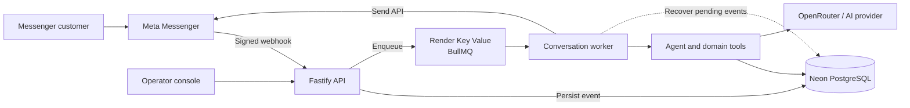

<div align="center">


# Monexis · AI Sales Agent

**A Messenger sales assistant for a fictional bakery**

From a customer's message to a verified product answer — with a human operator in control.

[](https://www.typescriptlang.org/)
[](https://nodejs.org/)
[](https://www.postgresql.org/)
[](https://bullmq.io/)
[](https://www.docker.com/)

[Project overview](#the-project) · [Verified demo](#verified-demo) · [Architecture](#architecture) · [Run locally](#run-locally) · [Limitations](#current-limitations)

</div>

---

## The project

Monexis is a portfolio project exploring a practical problem: **how can a small shop handle Messenger enquiries without letting an assistant invent prices, stock or order details?**

The service receives Meta webhooks, saves and queues incoming events, and gives an agent access to catalog, inventory, knowledge and checkout tools. An operator console exposes conversations, handovers and operational data. The bakery and its products are fictional demonstration data.

| Customer experience                                   | Engineering focus                                            |
| ----------------------------------------------------- | ------------------------------------------------------------ |
| Discover bakery products and ask about price or stock | Verify facts against PostgreSQL-backed tool results          |
| Continue a conversation or ask for a person           | Switch between AI, human and paused modes                    |
| Prepare an order and review its summary               | Separate order preparation from confirmation                 |
| Interact through a Facebook Page                      | Verify webhook signatures, deduplicate events and queue work |

## Verified demo

**Live service:** [fanpage-sales-agent.onrender.com](https://fanpage-sales-agent.onrender.com)  
**Health:** [/health](https://fanpage-sales-agent.onrender.com/health) · **Dependencies:** [/ready](https://fanpage-sales-agent.onrender.com/ready)  
**Operator console:** [/admin/](https://fanpage-sales-agent.onrender.com/admin/) — authentication required.

The service has been deployed on Render Free with Neon PostgreSQL. In a controlled Messenger test on the Monexis Page, the application:

1. Received and processed a message through the real Meta webhook.
2. Listed three bakery products with prices matching the database.
3. Answered a specific Butter Croissant price-and-stock question using product and inventory lookups for both variants.

These checks do **not** establish that every natural-language question, the complete checkout flow, or unrestricted public Messenger access works. Page access can be limited by the Meta app's development mode and permissions. Product names, prices and inventory are fictional.

> Render Free can sleep after inactivity; the first request may take time to wake it. This is a portfolio demonstration, not an always-on production service.

## What it does

### Customer-facing flow

- **Messenger integration** — receives and verifies signed Meta events, then sends replies through the Graph API.
- **Catalog-backed answers** — searches active products and checks variant prices and available inventory before rendering factual responses.
- **Agent tools** — supports bounded decisions across catalog, knowledge, cart and checkout operations, with structured tool results.
- **Human handover** — allows a conversation to be controlled by AI, assigned to a human, or paused.
- **Order safeguards** — prepares a server-side checkout summary and requires a matching confirmation before order creation.

### Behind the scenes

- Persists incoming events before enqueueing; event keys and jobs are deduplicated.
- Serializes work for a conversation and records agent runs and tool calls.
- Stores outbound intent before delivery and treats uncertain external sends conservatively.
- Recovers persisted pending events when the worker is running if the queue loses its contents.
- Uses a signed Admin session, CSRF protection and origin checks for the operator console.

## Architecture



| Area                     | Implementation                                                 |
| ------------------------ | -------------------------------------------------------------- |
| API and operator console | Fastify · React · TypeScript                                   |
| Messaging                | Meta Messenger webhooks and Graph API                          |
| Data and retrieval       | PostgreSQL · pgvector · typed domain repositories              |
| Background processing    | BullMQ · Redis / Valkey                                        |
| AI integration           | OpenRouter or OpenAI-compatible provider; structured decisions |
| Delivery                 | Docker · Render · Neon                                         |

The worker runs in the web-service process. Render's free queue is not persistent: PostgreSQL is the durable event source for recovery while the application is running. This does not guarantee recovery of an event that was never persisted, or exactly-once delivery to an external service.

## Repository map

```text
apps/
  api/            Fastify API, webhook ingress and workers
  admin/          React operator console
packages/
  config/         Environment validation
  db/             PostgreSQL repositories and migrations
  domain/         Agent, catalog, cart, checkout and knowledge logic
  meta/           Messenger adapters and webhook verification
  observability/  Logging and operational metrics
  queue/          BullMQ queue and worker infrastructure
scripts/          Demo seed, evaluation and operational scripts
docs/             Deployment runbooks, portfolio notes and release evidence
```

## Run locally

**Requirements:** Node.js 22+, pnpm 11.7, and Docker Desktop with Linux containers.

```powershell
pnpm.cmd install
Copy-Item -LiteralPath .env.example -Destination .env
docker compose up -d postgres redis
pnpm.cmd db:migrate
pnpm.cmd dev
```

The example configuration supports local fake adapters. Populate required values in your private `.env`; never commit credentials. For real Messenger or AI traffic, configure your own Meta app, Page token and provider credentials.

```powershell
Invoke-RestMethod http://127.0.0.1:3000/health
Invoke-RestMethod http://127.0.0.1:3000/ready
```

`/health` checks liveness. `/ready` checks the required PostgreSQL and Redis connections.

### Demo catalog

The bakery seed contains 12 fictional products and 24 variants. Run it only against the intended isolated demo database:

```powershell
pnpm.cmd seed:bakery-demo
```

**Do not rerun this seed on an active shop:** it archives the older apparel demo products and can reset inventory quantities and reservations. Review [the seed script](scripts/seed-bakery-demo.ts) before running it.

## Quality and operations

```powershell
pnpm.cmd lint
pnpm.cmd typecheck
pnpm.cmd test
pnpm.cmd test:integration
pnpm.cmd build
```

Integration tests require healthy local PostgreSQL and Redis. Stop the local API first so its worker cannot consume test jobs. Deterministic agent scenarios are useful regression tests; they do not replace testing a real model or a real Meta conversation.

- [Render + Neon deployment](docs/runbooks/render-neon.md)
- [VPS deployment](docs/runbooks/vps-deploy.md)
- [Recruiter walkthrough and CV wording](docs/portfolio-demo.md)
- [Release progress](docs/releases/2026-11-05-progress.md)

## Current limitations

- **Free hosting:** the Render web service sleeps without inbound traffic; the in-process worker also stops while it sleeps. Free Key Value can lose queue contents on restart.
- **AI reliability:** free-model availability and structured-output quality vary. The two verified catalog scenarios are not proof that arbitrary questions or all agent paths work.
- **Meta access:** production permissions, app review and access for people outside the app's test roles remain dependent on Meta.
- **Checkout:** implementation and local tests exist; a complete live order flow has not yet been verified end to end.
- **Operations:** single-instance session revocation and rate-limit state are process-local. Off-host backups, monitoring and alert delivery require separate setup and verification.
- **Demo data:** the bakery catalog is fictional and should not be presented as a real shop inventory.

## Security

Webhook signatures are verified over the raw request body before processing. Keep Meta tokens, database connection strings, AI keys and Admin secrets out of Git and chat. Do not expose PostgreSQL or Redis publicly. Use the [deployment runbook](docs/runbooks/render-neon.md) for configuration and operational details.
